# Crop and Weed Detection with YOLO26n

[](https://colab.research.google.com/github/nursoulqxw/Object_Detection/blob/main/notebooks/colab_training.ipynb)

Deep Learning (CSCI1409), bonus project. Author: **Aliyev Nurislam**, student ID: **24B030024**.

This repository trains an object detector that finds **sesame crop** plants and **weeds** in field photos.
It fine-tunes a pretrained **YOLO26n** model (Ultralytics) and runs completely in Google Colab:
data download, label check, leakage-safe split, training, a controlled experiment, test evaluation and predictions.

---

## 1. How to run

1. Click the **Open in Colab** badge above.
2. **Runtime → Change runtime type → T4 GPU → Save.** The first code cell (`nvidia-smi`) must show "Tesla T4".
   On CPU, training takes hours.
3. **Runtime → Run all.** Total time on a free T4: about 25 minutes.

The notebook clones this repository, installs the pinned versions from `requirements.txt`,
downloads the dataset with `kagglehub`, builds the split, trains both models, evaluates the final model on the test set,
and shows predictions. No Kaggle login was needed for this public dataset in our runs.

Note: Colab may print a pip warning that `gradio` requires `pillow<13`. It can be ignored; `gradio` is not used.

**Final trained weights:** [best_experiment.pt (experiment, imgsz 640)](https://github.com/nursoulqxw/Object_Detection/releases/download/v1.0/best_experiment.pt)
Baseline weights (for comparison): [best.pt (baseline, imgsz 512)](https://github.com/nursoulqxw/Object_Detection/releases/download/v1.0/best.pt)
Both checkpoints are the `best.pt` selected by Ultralytics on validation results and are stored in the [v1.0 release](https://github.com/nursoulqxw/Object_Detection/releases/tag/v1.0), not in Git.

To use the weights without training:

```python
from ultralytics import YOLO
model = YOLO("best_experiment.pt")
results = model.predict("image.jpeg", imgsz=640, conf=0.25)
```

### Repository structure

```
configs/baseline.yml        training settings, baseline (imgsz 512)
configs/experiment.yml      same settings, only imgsz changed to 640
notebooks/colab_training.ipynb
src/download_data.py        downloads the dataset with kagglehub
src/prep_dataset.py         label check, near-duplicate grouping, group split, data.yaml
src/show_gt.py              draws ground-truth boxes (res/gt_examples.png)
src/train.py                trains a model from a config file, saves training time
src/evaluate.py             evaluates a model on the test set (res/test_metrics.json)
src/predict.py              ground truth vs. prediction images (res/preds/)
res/                        saved evidence: split, figures, logs, curves, metrics
requirements.txt            pinned dependency versions
```

`data/`, `runs/` and model weights are not stored in Git. The notebook recreates `data/` and `runs/`.

---

## 2. Dataset

| | |
|---|---|
| Name | Crop and Weed Detection Data with Bounding Boxes |
| Source | [Kaggle: ravirajsinh45/crop-and-weed-detection-data-with-bounding-boxes](https://www.kaggle.com/datasets/ravirajsinh45/crop-and-weed-detection-data-with-bounding-boxes) |
| Authors | Panara Utsav, Pandya Raviraj, Mohit Rayja (2020) |
| Usage terms | CC0 1.0 (public domain), as listed for this dataset by [Dataset Ninja](https://datasetninja.com/crop-weed-detection) |
| Content | 1,300 color images, 512 × 512 px, sesame crop and several weed types |
| Classes | `0: crop`, `1: weed` |
| Annotation format | YOLO: one `.txt` per image, one line per box: `class x_center y_center width height` (all values 0–1) |
| Total objects | 2,072 (1,212 crop, 860 weed) |

According to the authors, 589 photos were collected and the rest of the 1,300 images are augmented copies.

### Ground-truth examples

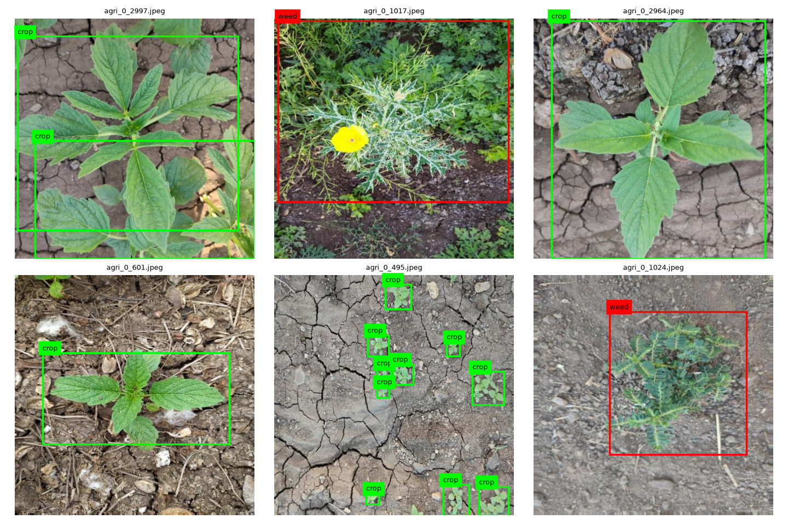

Green = crop, red = weed. One image per group (see the split below).

### Label check

**Format check** (`prep_dataset.py`, all 1,300 files): every image has a label file, every line has 5 values,
class IDs are 0 or 1, all coordinates are in 0–1, no box has zero size, no image is empty. **0 problems found.**

**Visual check** (12 training images, notes in [`res/label_check.md`](res/label_check.md)): the format is correct, but the content has problems:

| Image | Problem |
|---|---|
| agri_0_2158 | small seedlings without boxes |
| agri_0_6547, agri_0_6353, agri_0_2997 | plants at the image edge without boxes |
| agri_0_601 | small plant in a corner without a box |
| agri_0_1017 | one loose box over several weeds; other weeds unlabeled |
| agri_0_1361 vs. agri_0_495 | inconsistent style: one box for a whole cluster vs. one box per seedling |
| agri_0_1494 | labeled weed, but appears to be the same species as crop plants (e.g. agri_0_2964) |
| agri_0_3647 | edge-stretching artifact from augmentation |

Labels on large, centered plants are good. Problems appear with small plants, plants at image edges and dense clusters.
**Labels were not changed.** These problems lower the measured precision and recall (see the failure analysis).

---

## 3. Data split (no leakage)

The dataset has only one folder, so I created my own train / validation / test split.

**Problem:** most images are flipped or rotated copies of another image.
A random split would put copies of the same photo into train and test, so the test score would be too high.

**Method** (`src/prep_dataset.py`):

1. For every image, compute a **perceptual hash** (pHash, 64 bits) of 8 versions: 4 rotations × with/without mirror.
2. Two images are copies if the Hamming distance between their hashes is **≤ 10 bits**
   (over all 8 versions, so flips and rotations are matched).
3. Connect copies into **groups** (union-find).
4. Shuffle the groups with **random seed 42** and fill train → 70%, val → 15%, test → rest.
   A group is never split.

**Result:** every image had a near-copy within 10 bits (783 images at 0 bits).
The 1,300 images come from **287 groups** (distinct photos). I checked groups visually:
each group contains rotations / flips of a single photo (largest group: 17 variants).

| Split | Groups | Images | crop objects | weed objects | Total objects |
|---|---|---|---|---|---|
| train | 202 | 916 | 804 | 580 | 1,384 |
| val | 41 | 190 | 171 | 146 | 317 |
| test | 44 | 194 | 237 | 134 | 371 |

The list of which image is in which split is saved in [`res/split.csv`](res/split.csv).
The split is reproducible: re-running `prep_dataset.py` on a fresh Colab runtime gives exactly the same table.
The test set is slightly crop-heavy (64% crop vs. 58% overall), because whole groups cannot be balanced perfectly.

---

## 4. Baseline training

| Setting | Value |
|---|---|
| Framework | Ultralytics 8.4.215 (Python 3.13, PyTorch 2.14.1 + CUDA, Colab Tesla T4) |
| Model | YOLO26n (2.5 M parameters) |
| Initial weights | `yolo26n.pt`, pretrained on COCO (80 classes); the class head is replaced for 2 classes |
| Image size | 512 (native size of the images) |
| Batch size | 16 |
| Epochs | 30 |
| Optimizer / learning rate | SGD, `lr0 = 0.01`, final LR factor `lrf = 0.01`, momentum 0.937 |
| Random seed | 42, `deterministic = true` |
| Augmentation | Ultralytics defaults (mosaic, horizontal flip, HSV, scale, translate) |
| Best checkpoint | `best.pt`, selected by Ultralytics on validation fitness |
| Training time | 6.5 min |

The optimizer is set to SGD on purpose: with the default `optimizer: auto`, Ultralytics chooses the learning rate itself and ignores `lr0`.

Saved for each run in `res/baseline/` and `res/experiment/`:
`args.yaml` (full configuration), `results.csv` (per-epoch log), `results.png` (learning curves), `train_time.txt`.

Running the training twice with the same seed on a T4 gave the same validation results.

---

## 5. Controlled experiment: image size 512 → 640

**Only one setting changed:** `imgsz` 512 → 640. Data split, pretrained weights, epochs, batch size,
optimizer, learning rate and seed are identical (`diff configs/baseline.yml configs/experiment.yml` shows only `imgsz` and the run name).

**Hypothesis (stated before training):** a larger input makes small seedlings larger in pixels, so **recall should increase**,
at the cost of about 1.5× training time. Because the original images are only 512 px, upscaling adds no new detail, so the gain may be small.

**Validation results** (190 images, 41 groups, `best.pt` of each run):

| Run | Changed setting | Precision | Recall | mAP@0.50 | mAP@0.50:0.95 | Training time |
|---|---|---|---|---|---|---|
| baseline | imgsz 512 | 0.782 | **0.797** | 0.818 | **0.524** | **6.5 min** |
| experiment | imgsz 640 | **0.810** | 0.790 | **0.843** | 0.518 | 8.4 min |

**Learning curves.** Each small chart shows one value per epoch (x-axis: epoch 1–30).
Blue line = the real value after each epoch; orange dotted line = a smoothed version that shows the trend.
Top-left charts are training losses, bottom-left are validation losses (lower is better);
the right charts are validation metrics (higher is better).

| Baseline (imgsz 512) | Experiment (imgsz 640) |
|---|---|
| 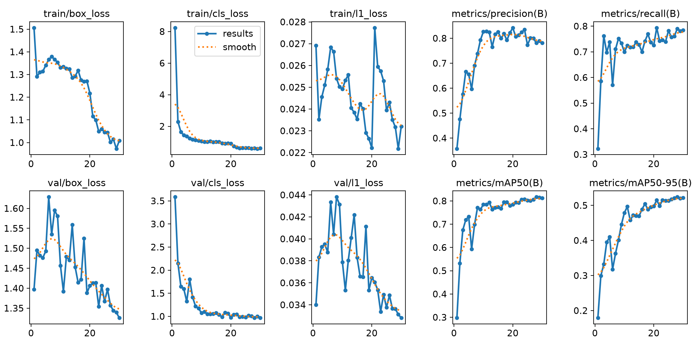 | 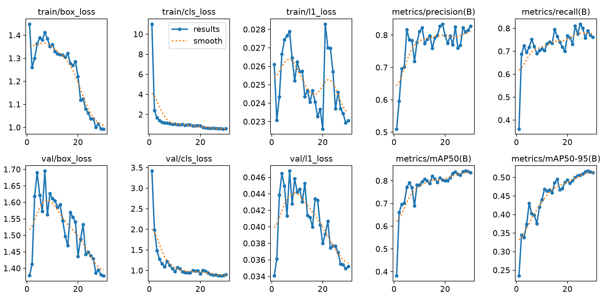 |

- `box_loss` / `l1_loss`: how wrong the box positions are. `cls_loss`: how wrong the class (crop or weed) is.
- Both runs train correctly: all losses go down and all metrics go up.
- No overfitting: validation losses are still decreasing at epoch 30, so slightly longer training could help.
- The sharp drop in `train/box_loss` at epoch 20 is where mosaic augmentation is switched off (`close_mosaic=10`):
  the last 10 epochs use normal single images, which are easier than mosaic images (4 photos glued into one).
- `cls_loss` starts high (8–11) because the 2-class output layer is new and random; it learns crop vs. weed in 2–3 epochs.
- The experiment learns faster (mAP50 ≈ 0.66 vs. 0.53 at epoch 2) and ends higher in mAP50 and precision,
  while recall and mAP50-95 end at about the same level.
- Loss values are not compared between the runs, because they depend on image size; only metrics are compared.
- Metric curves are noisy because validation has only 41 independent photos.

**Explanation:**

- mAP@0.50 increased by 0.025, but **through precision, not recall**. The hypothesis about recall was **not confirmed**.
- A likely reason: more pixels per plant help the model separate plants from soil, stones and shadows, so there are fewer false boxes.
  But missed small seedlings are not fixed by upscaling an image that has no extra detail.
- mAP@0.50:0.95 did not improve (0.524 → 0.518), so boxes did not become tighter.
- Training time increased by about 30%, less than expected, because for such a small model a large part of each epoch is data loading and validation.
- **Limitation:** one run per setting and only 41 validation groups. Part of the 0.025 difference may be noise;
  2–3 seeds per setting would be needed to be sure.

**Final model:** the experiment (imgsz 640), chosen because it has the higher **validation** mAP@0.50.
The test set was not used for this choice.

---

## 6. Test results (final model)

The final model was evaluated **once** on the 194 test images.

Evaluation settings: `conf = 0.001` (keep all predictions, needed for mAP), NMS `iou = 0.7` (remove duplicate boxes),
mAP match threshold IoU = 0.50. Saved in [`res/test_metrics.json`](res/test_metrics.json).

| Class | Images | Objects | Precision | Recall | mAP@0.50 |
|---|---|---|---|---|---|
| **all** | 194 | 371 | **0.837** | **0.742** | **0.835** |
| crop | 94 | 237 | 0.797 | 0.760 | 0.856 |
| weed | 100 | 134 | 0.878 | 0.724 | 0.815 |

**What the metrics mean:**

- **Precision:** of all predicted boxes, the share that are correct. Low precision = many false alarms.
- **Recall:** of all true objects, the share the model found. Low recall = many missed objects.
- **mAP@0.50:** a prediction is correct if it has the right class and overlaps a true box with IoU ≥ 0.50.
  AP is the area under the precision–recall curve over all confidence levels; mAP is the average over both classes.
- Ultralytics reports precision and recall at the confidence threshold with the best F1 score.

**Interpretation:** test mAP@0.50 (0.835) is very close to validation (0.843), so the model generalizes to new photos
and the group split worked. Recall (0.742) is lower than precision (0.837): the main weakness is **missed plants**.
Weed has high precision but lower recall, so the model is careful with weeds, which look more varied than crop.

---

## 7. Predictions on test images

Left: ground truth. Right: prediction with class name and confidence (`conf ≥ 0.25`, the Ultralytics default for prediction).
All 44 test groups are in [`res/preds/`](res/preds/).

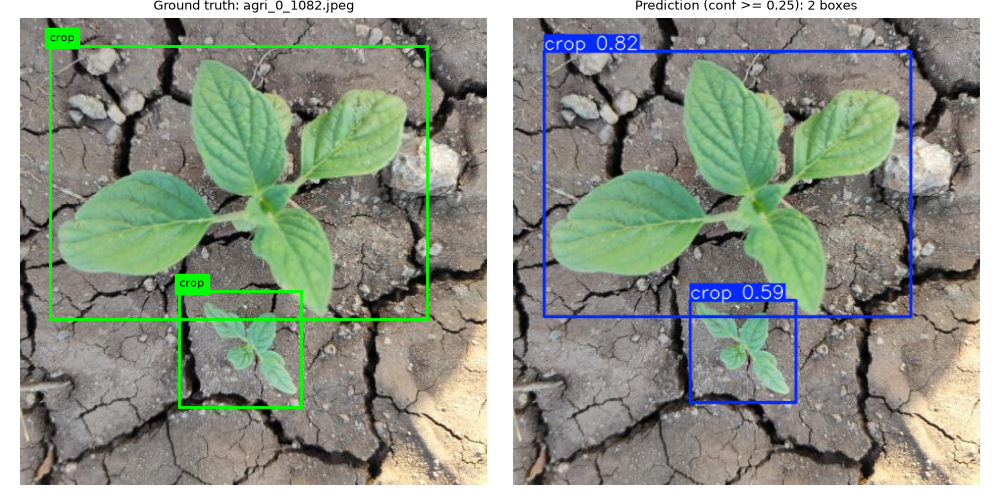

*agri_0_1082: two crop plants, one large and one small seedling, both found with correctly placed boxes (0.82, 0.59).*

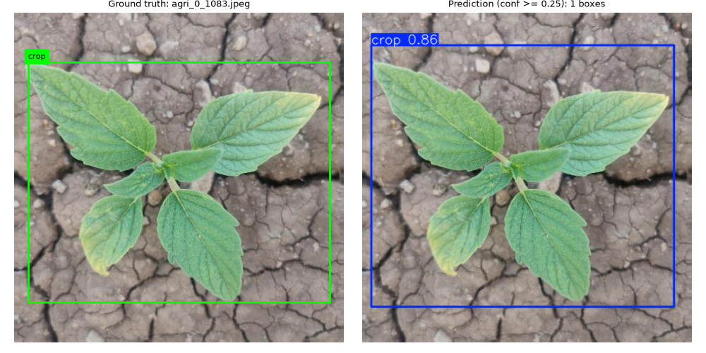

*agri_0_1083: a single crop plant on cracked soil, detected with a tight box (0.86).*

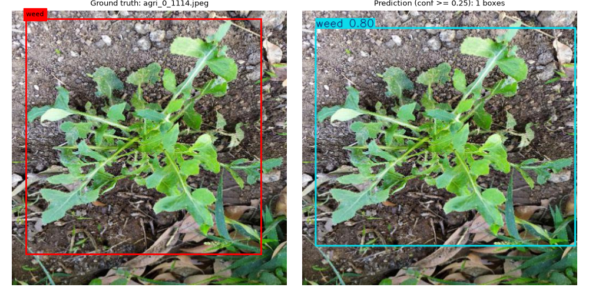

*agri_0_1114: a large, spread-out weed, correctly classified as weed with a box matching the ground truth (0.80).*

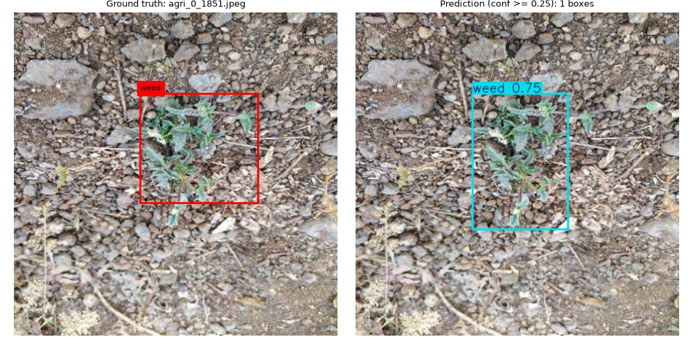

*agri_0_1851: a small weed on stony ground, found and classified correctly despite the busy background (0.75).*

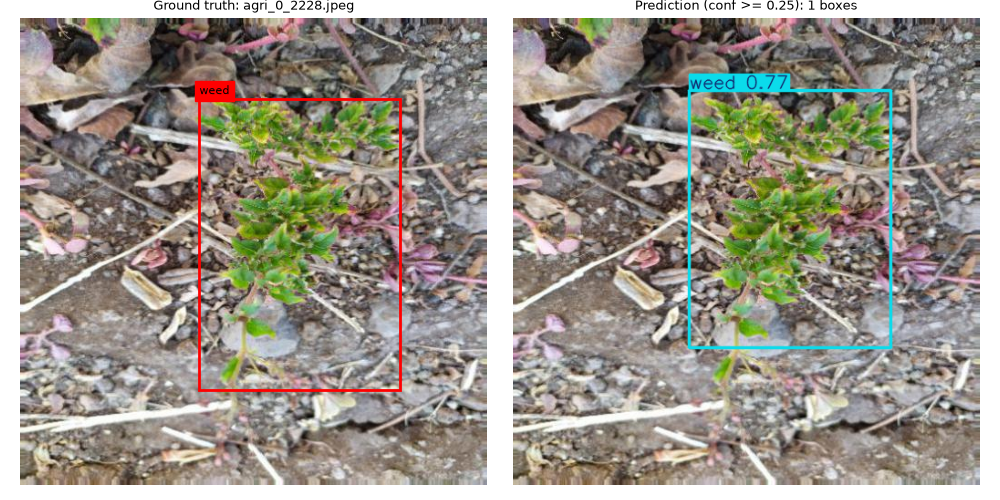

*agri_0_2228: a weed among dry leaves and debris, detected as weed with no false boxes on the clutter (0.77).*

---

## 8. Failure analysis

Candidates were found automatically (notebook section 8): test images where the number of predicted boxes
differs most from the number of true boxes. Then I checked them visually.

### Failure 1: missed small seedlings (`agri_0_14`, 19 true boxes → 9 predicted)

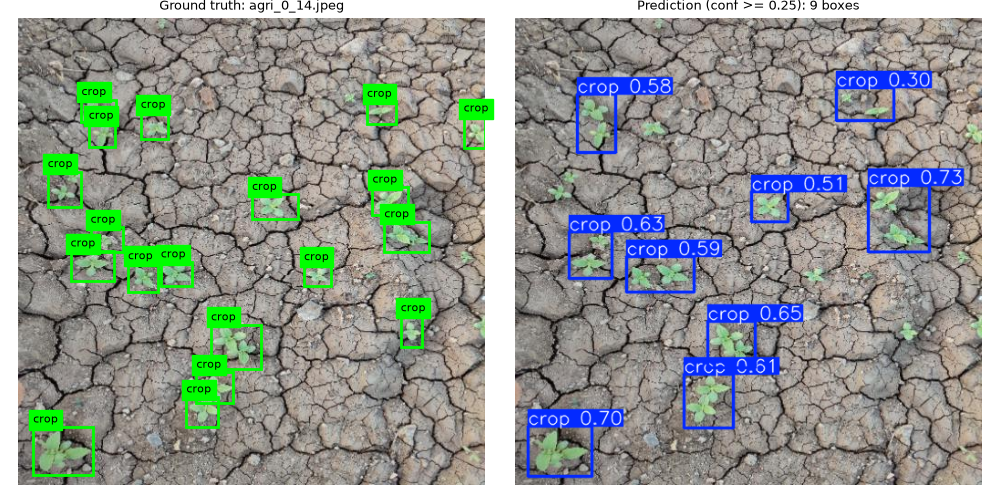

- **What happened:** many tiny seedlings get no box. Several predicted boxes cover **two** neighboring seedlings that have separate true boxes. Confidences are low (0.30–0.73).
- **Likely cause:** the seedlings are only about 20–30 px wide, which is hard for a nano model.
  The training labels are inconsistent (sometimes one box per seedling, sometimes one box per cluster), so the model has no clear rule for neighbors.
- **Type:** missed objects (a real model error).

### Failure 2: cluster vs. single plants (`agri_0_1499`, 11 → 14)

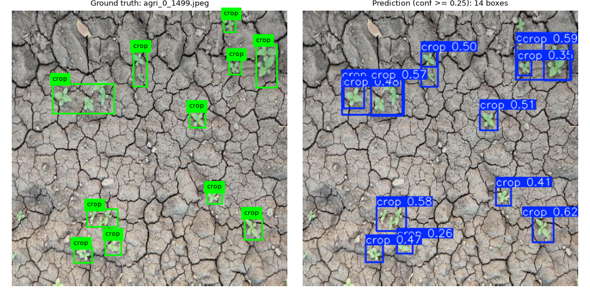

- **What happened:** the ground truth has one wide box over 3 seedlings; the model predicts a separate box for each.
  In the top right the model predicts a large box around two seedlings **and** small boxes for each of them (duplicates).
- **Likely cause:** the same labeling inconsistency as failure 1, in the opposite direction. The model's answer is arguably better than the label,
  but it counts as false positives plus a missed box. The nested boxes stay because a small box inside a large box has low IoU,
  so duplicate removal does not treat them as the same object.
- **Type:** mostly a labeling problem, plus a real duplicate-box error.

### Failure 3: "false" detections that are real plants (`agri_0_6978`, 1 → 3)

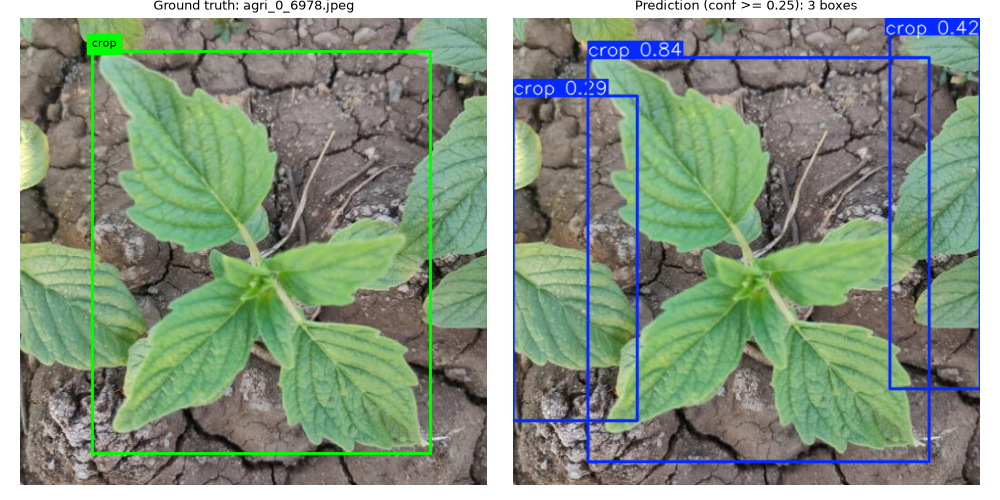

- **What happened:** the center plant is found correctly (0.84). The two extra boxes (0.29, 0.42) are on real plants cut off at the image edges.
- **Likely cause:** the labelers did not label partially visible plants at the edges (also seen in the label check).
- **Type:** a labeling problem. The model is right, but these count as false positives and lower the measured precision.

### Practical next step

**Make the labels consistent and re-evaluate:** use two clear rules, *one box per plant* and *label partially visible plants at the edges*,
and relabel at least the validation and test sets (for example in CVAT or Roboflow).
This fixes failures 2 and 3 directly and gives the model a clear rule for failure 1.
For the small seedlings, tiled inference (predicting on overlapping crops) is a possible second step.

---

## 9. Limitations

- Labels are noisy (missing edge plants, inconsistent cluster boxes, a possible class error), so the metrics underestimate real performance.
- There are only 287 distinct photos; validation and test have 41 and 44 independent groups, so metrics have high variance.
- The experiment uses one seed per setting.
- All photos come from one field and season, so performance on other crops, soils or lighting is unknown.

---

## 10. Credits and acknowledgments

- **Ultralytics YOLO** (AGPL-3.0): training, evaluation and prediction framework, and the pretrained `yolo26n.pt` weights.
- **Dataset:** Panara Utsav, Pandya Raviraj, Mohit Rayja (2020), *Crop and weed detection data with bounding boxes*, Kaggle, CC0 1.0.
- Libraries: `kagglehub`, `ImageHash`, `Pillow`, `matplotlib`, `PyYAML`, `pandas`.

**My own work:** the label check, near-duplicate grouping with perceptual hashing, the group-based split,
the training / evaluation / prediction scripts, the controlled experiment, and the failure analysis.

**Use of AI tools:** I used ChatGPT and Claude as tutors: to choose the dataset, plan the project,
explain concepts, and help debug and review code. I wrote and ran the code myself and checked all results.
